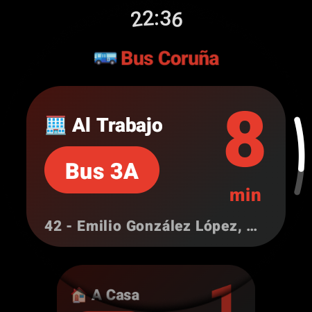
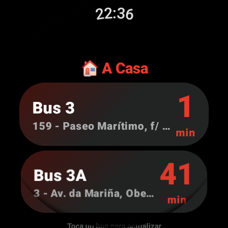
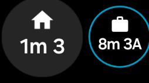
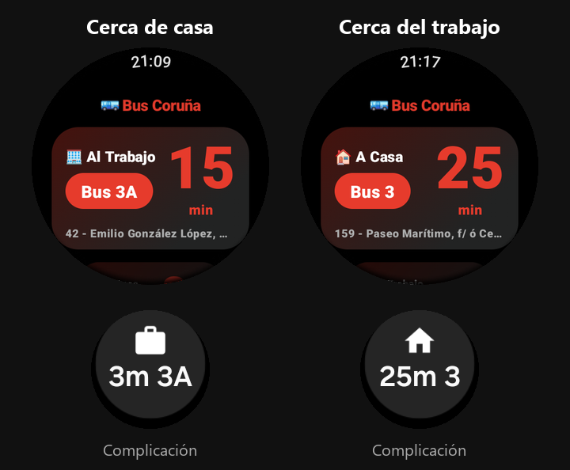
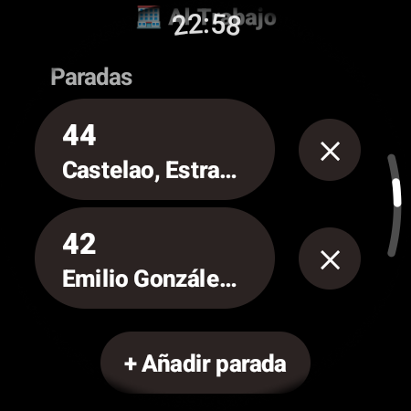
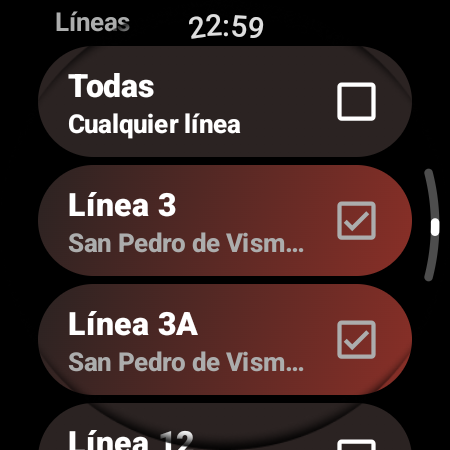
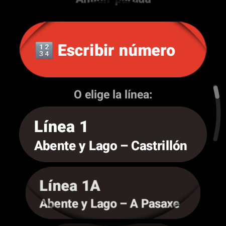
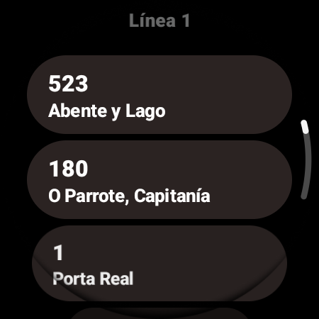
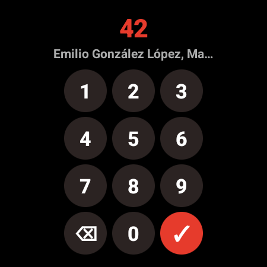
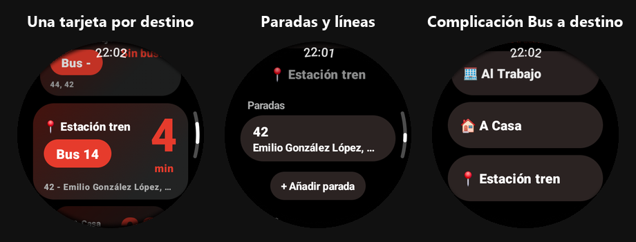

# 🚌 BusCoruña

Aplicación para relojes **Wear OS** que muestra cuánto falta para que llegue el autobús urbano de A Coruña, tanto **para ir al trabajo** como **para volver a casa** (o a los destinos que añadas), sin sacar el móvil.

Los tiempos se obtienen en directo del servicio de información de iTranvías.

<p align="center">
  
  &nbsp;&nbsp;
  
</p>
<p align="center">
  
</p>

## Funciones

- **Dos rutas: al trabajo y a casa.** Cada tarjeta muestra el próximo bus que te sirve, los minutos que faltan en grande y la parada donde cogerlo.
- **Destinos personalizados.** Además de casa y trabajo, puedes añadir los tuyos (gimnasio, estación…), cada uno con sus paradas y líneas.
- **Orden según dónde estás.** Cerca de casa, la primera tarjeta es "Al Trabajo"; cerca del trabajo, "A Casa".
- **Varias paradas y líneas por ruta.** Si puedes coger el bus en más de una parada o te valen varias líneas, la app elige el que llega antes.
- **Lista de próximos buses.** Al tocar una tarjeta se ven todos los buses que vienen para esa ruta, ordenados por minutos.
- **Complicaciones para la esfera.** "Bus al trabajo" y "Bus a casa" muestran el tiempo restante y la línea directamente en la esfera, con una cuenta atrás que se actualiza sola. "Bus Trabajo-Casa" ocupa un solo hueco y cambia de ruta e icono según dónde estés. "Bus a destino" muestra el destino que elijas al ponerla.
- **Configuración desde el reloj.** Las paradas se eligen por línea (viendo su recorrido) o tecleando el número. Las líneas se marcan de una lista que solo incluye las que pasan por tus paradas.
- **Nombres reales de las paradas**, obtenidos del catálogo oficial de la red.

## Uso

### Pantalla principal

Al abrir la app aparece una tarjeta por destino: **🏢 Al Trabajo**, **🏠 A Casa** y los que añadas (**📍 Estación tren**). Cada una muestra:

- la **línea** del próximo bus que cumple tu configuración (por ejemplo, *Bus 3A*);
- los **minutos** que faltan para que llegue;
- la **parada** donde pasa: `42 - Emilio González López, Manuel Azaña`.

Los tiempos se actualizan cada vez que abres la app o vuelves a ella.

### Orden según la ubicación

La primera tarjeta es la de la ruta que sale de donde estás. La app compara tu distancia a la parada más cercana de cada destino: las de "Al Trabajo" están junto a casa y las de "A Casa" junto al trabajo. Si dos destinos salen de las mismas paradas, va primero el que se creó antes. No hace falta guardar ninguna dirección; se usan las coordenadas de las paradas configuradas.

<p align="center">
  
</p>

- La primera vez la app pide permiso de **ubicación aproximada**, suficiente para distinguir casa de trabajo.
- Los tiempos se cargan sin esperar a la ubicación; las tarjetas se recolocan en cuanto llega.
- Sin permiso o sin ubicación, se mantiene el último orden.

### Próximos buses

Toca una tarjeta para ver **todos los buses** que vienen para esa ruta, de cualquiera de tus paradas y líneas, ordenados de menor a mayor tiempo de espera. El primero de la lista es el mismo que el de la tarjeta.

Toca cualquier bus de la lista para actualizarla.

### Configuración

Desde **⚙️ Configuración**, al final de la pantalla principal, se ajusta cada ruta por separado.

<p align="center">
  
  &nbsp;
  
</p>

**Paradas**

- **+ Añadir parada** abre la lista de líneas. Elige una para ver sus paradas en el orden del recorrido y toca la tuya.
- Si ya conoces el número, usa **🔢 Escribir número**: un teclado numérico muestra el nombre de la parada mientras escribes y no deja guardar una que no exista.
- Toca una parada añadida para cambiarla por otra, o pulsa **✕** para quitarla.

<p align="center">
  
  &nbsp;
  
  &nbsp;
  
</p>

**Líneas**

- Solo aparecen las líneas que pasan por las paradas de esa ruta. Marca las que te sirven.
- Con **Todas** marcada, se muestra cualquier bus.

Valores por defecto:

| Ruta | Paradas | Líneas |
|---|---|---|
| 🏢 Al trabajo | 42 y 44 | 3 y 3A |
| 🏠 A casa | 159 y 3 | 3 y 3A |

**Destinos**

- **+ Añadir destino**, debajo de Casa y Trabajo, pide el nombre con el teclado o el dictado del reloj.
- El destino nuevo aparece con su sección de **Paradas** y **Líneas**. Sus paradas son donde coges el bus para ir allí. Mientras no tenga ninguna, su tarjeta muestra "Sin paradas".
- **🗑 Borrar destino** lo elimina (pide tocar dos veces). Casa y Trabajo no se pueden borrar.

<p align="center">
  
</p>

**Ubicación**

- **Segundo plano** permite que la complicación "Bus Trabajo-Casa" consulte tu posición sin abrir la app. Al activarlo se abre la página de permisos del sistema: elige **Permitir siempre**.
- Para quitarlo, toca de nuevo el interruptor y cambia el permiso en esa misma página.

### Complicaciones en la esfera

1. Mantén pulsada la esfera y entra en **Personalizar**.
2. Ve a **Complicaciones**, toca el hueco que quieras y elige **BusCoruña**.
3. Selecciona **Bus al trabajo**, **Bus a casa**, **Bus Trabajo-Casa** o **Bus a destino**.

**Bus Trabajo-Casa** muestra siempre el bus al trabajo o a casa: el bus al trabajo con el maletín cuando estás cerca de casa y el bus a casa con la casa cuando estás cerca del trabajo. Con **Configuración → Ubicación → Segundo plano** activado cambia sola, en la siguiente actualización (como mucho cada 5 minutos). Sin ese permiso, cambia cuando abres la app en el nuevo sitio.

**Bus a destino** abre una lista para elegir qué destino muestra ese hueco, así que puedes poner una por destino. Para cambiarlo, vuelve a editar ese hueco de la esfera. Si borras el destino, la complicación muestra "Elige".

| Tamaño | Qué se ve |
|---|---|
| Círculo pequeño | Icono de la ruta (💼, 🏠 o 📍) y el tiempo con la línea: `8m 3A` |
| Alargada | `Bus 3A en 8 min` y la parada |

La esfera hace la cuenta atrás por sí sola. Wear OS solo deja actualizar una complicación cada 5 minutos como mínimo, así que la app vuelve a consultar con esa frecuencia y, además, cada vez que la abres. Al tocar la complicación se abre la lista de próximos buses de esa ruta.

El color del icono lo decide la esfera. En muchas esferas se puede cambiar desde **Personalizar → Color**.

## Instalación

No está publicada en Google Play: hay que compilarla e instalarla desde Android Studio.

### Requisitos

- Reloj con **Wear OS** (Android 8.0 o superior). Probada en un Samsung Galaxy Watch4.
- [Android Studio](https://developer.android.com/studio) con el SDK de Android 33.
- **JDK 17**. El proyecto usa Kotlin 1.7, que falla con JDK más recientes. En Android Studio, configúralo en **Settings → Build Tools → Gradle → Gradle JDK**; para la terminal, apunta `JAVA_HOME` a un JDK 17.

### Pasos

1. Clona el repositorio y ábrelo en Android Studio.
2. En el reloj, activa **Ajustes → Opciones para desarrolladores → Depuración inalámbrica** y vincúlalo desde **Device Manager → Pair Devices Using Wi-Fi**.
3. En **Build → Select Build Variant…** elige **release**. La variante debug funciona, pero es bastante más lenta en el reloj.
4. Selecciona el reloj y pulsa **Run ▶**.

Desde la terminal:

```bash
./gradlew :app:assembleRelease
adb install -r app/build/outputs/apk/release/app-release.apk
```

La build release se firma con la clave de depuración para poder instalarla directamente. Para distribuirla habría que configurar una clave propia en `app/build.gradle`.

## Cómo funciona

- **Datos:** consulta directamente la web de iTranvías (`itranvias.com/queryitr_v3.php`):
  - `func=0`: próximos buses de una parada;
  - `func=7`: catálogo de líneas y paradas con sus recorridos y coordenadas. Se guarda en el reloj y se renueva cada 7 días.
- **Ubicación:** Fused Location de Google Play Services, con precisión aproximada. Usa el GPS del reloj o la ubicación del móvil, la que esté disponible.
- **Arquitectura:** capas `datasource` → `repository` → `presentation`/`ui`, con Jetpack Compose for Wear OS para la interfaz y una `SuspendingComplicationDataSourceService` para las complicaciones.
- **Rendimiento:**
  - las paradas de las dos rutas se consultan en paralelo con un único cliente HTTP compartido;
  - la build release usa R8 e incluye un Baseline Profile para arrancar más rápido.

```
app/src/main/java/com/esanchon/buscorua/presentation/
├── complication/   Complicaciones de la esfera
├── datasource/     API de iTranvías, catálogo y configuración guardada
├── domain/         Modelos (rutas, paradas, líneas, llegadas)
├── presentation/   Presenter de la pantalla principal
├── repository/     Combina datos y aplica los filtros de cada ruta
├── theme/          Colores y tipografía
└── ui/             Pantallas (principal, detalle, configuración, selectores)
```

## Aviso

Proyecto personal sin relación con la Compañía de Tranvías de La Coruña ni con iTranvías. Usa un servicio web público no documentado que puede cambiar o dejar de funcionar sin aviso. Los tiempos son estimaciones del propio servicio.

## Licencia

El código se distribuye bajo la [licencia MIT](LICENSE). El logotipo "TC" del icono de la app pertenece a la Compañía de Tranvías de La Coruña y no está cubierto por esta licencia.
